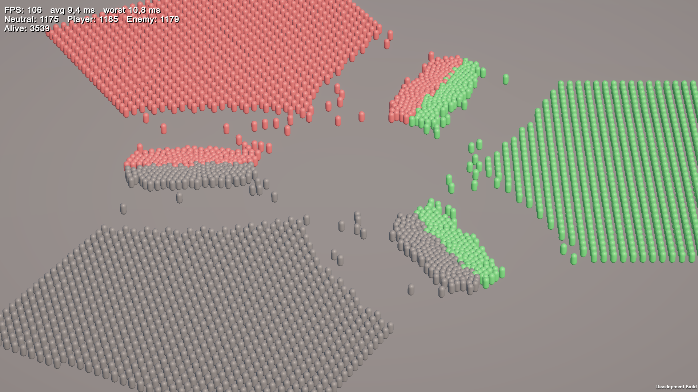
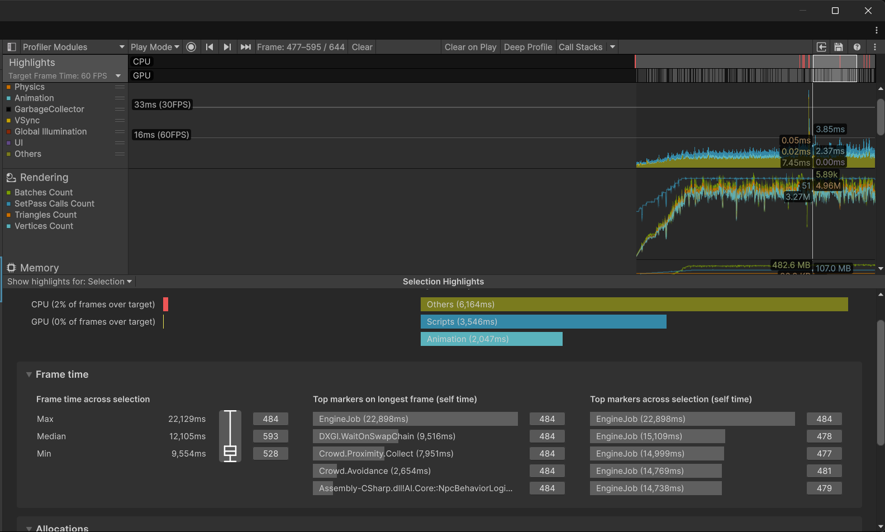
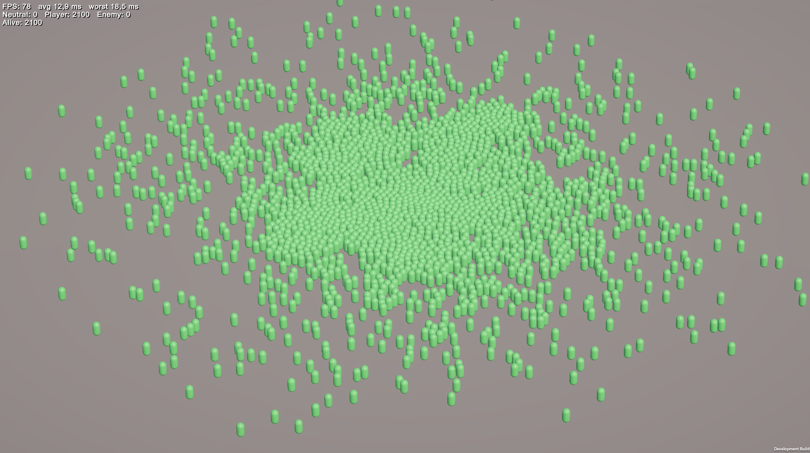
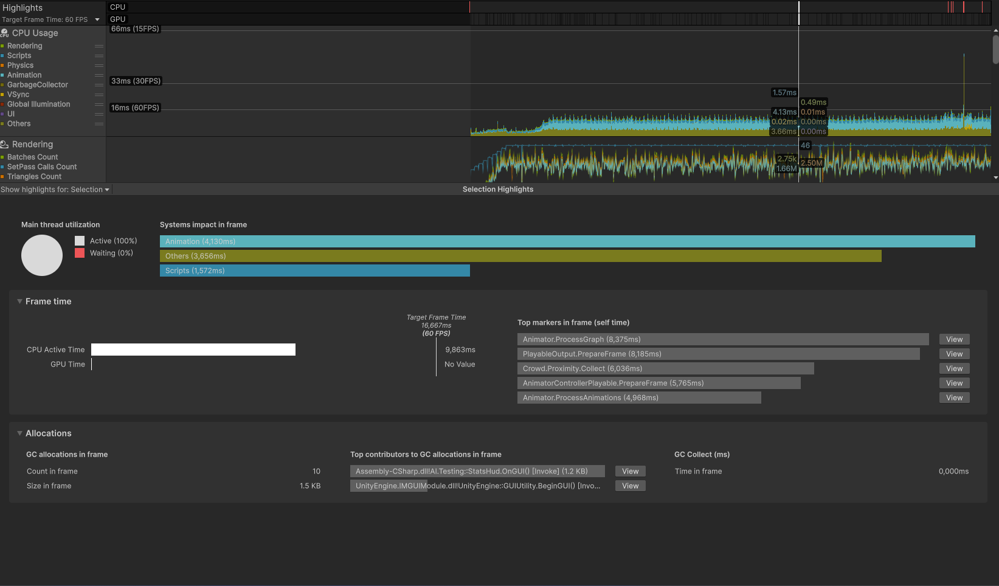

# NpcArena

Арена для массового боя NPC в Unity. Три фракции, каждая выставляет свои отряды, и все дерутся со всеми. Делал, чтобы понять, сколько NavMesh-агентов реально держит ноутбук и на что на самом деле уходит кадр.

Сейчас держит около 3600 NPC (3 фракции по ~1200), медиана кадра 12.1 ms. За бюджет 60 FPS вылезает примерно 2% кадров.



## Замеры

Development build (Mono), Unity 6000.3.10f1, URP, ноут HP Victus 15-fb3xxx. Смотрел CPU Active Time в Unity Profiler, p99 считал по файлам `.highlights`. Из худшего кадра выкинул то, что к игре не относится: скриншоты, переключение окон, загрузку сцены.

| Что поменял | NPC | Медиана | p99 | Худший кадр |
|---|---|---|---|---|
| Ничего, как было | 2100 | 15.3 ms | 50.0 ms | 85 ms |
| Разделил сетку поиска по фракциям | 2100 | 14.6 ms | 21.3 ms | 28 ms |
| Упростил NavMesh avoidance | 2100 | 11.6 ms | 15.6 ms | 20 ms |
| Выключил Animator в `Idle` | 3600 | 12.1 ms | — | 22 ms |

Юнитов в итоге на 70% больше, а кадр всё равно быстрее, чем был в начале. Раньше в 60 FPS не влезало 20–28% кадров, теперь 2%.



## Три режима: бой, сходка, ходьба

Потом захотелось понять, что дороже: сам бой или то, что толпа двигается. Сделал в `ArenaSpawner` три режима спавна и прогнал каждый на одинаковых 2100 NPC.

- **Mixed** — все одной сеткой вперемешку, фракции шахматкой. Враг у каждого стоит вплотную, бой начинается с первого кадра.
- **Squads** — обычный режим: три отряда по кругу идут навстречу и сходятся.
- **Roam** — все одной фракции, драться не с кем. Каждый идёт в случайную точку в круге, дошёл — берёт следующую. Толпа ходит без остановки.

Эти замеры делал на другой машине (стационарный ПК, ASUS), поэтому с таблицей выше их напрямую не сравнить. Development build, захват после спавна, без скриншотов во время записи.

| 2100 NPC, ПК | Mixed | Squads | Roam |
|---|---|---|---|
| Медиана | 3.9 ms | 6.5 ms | 10.8 ms |
| p95 | 5.8 ms | 8.3 ms | 14.2 ms |
| p99 | 6.5 ms | 9.2 ms | 15.3 ms |
| Худший кадр | 10.1 ms | 11.1 ms | 19.3 ms |
| Кадров дольше 16.7 ms | 0 | 0 | 5 |

Я ожидал, что тяжелее всего будет Mixed, где все дерутся одновременно. Вышло наоборот. В Mixed враг рядом, юниты сразу встают в `Attack`/`Defend` и никуда не идут, а там у них выключен avoidance. В Roam двигаются все 2100 сразу, у всех работает NavMesh crowd и включён Animator.





В профайлере Roam сверху одни Animator (`ProcessGraph`, `PrepareFrame`, `ProcessAnimations` — суммарно ~27 ms в worker-потоках) и `Crowd.Proximity.Collect` (~6 ms). Мои скрипты на главном потоке — 1.6 ms. Выходит, логика NPC (поиск, FSM, `Think`) почти ничего не стоит, а кадр съедают движение толпы и анимация.

## Что тормозило

**Поиск врага перебирал своих.** В клетке сетки лежали все юниты подряд, а фракцию я проверял уже внутри цикла. Пока отряды стоят плотно и далеко от врага, каждый NPC перебирает сотни союзников и ничего не находит. Когда отряды сходились, кадр рос в 2–3 раза, пики доходили до 85 ms.

Поменял ключ клетки на `(x, z, faction)`. Теперь поиск ходит только по спискам чужих фракций, своя толпа в нём не участвует.

**NavMesh crowd.** После этого наверх профайлера вылез `Crowd.Proximity.Collect`. Это `NavMeshAgent` собирает соседей для обхода препятствий. Помогло вот что:

- `NavMesh.avoidancePredictionTime = 0.5f` (по умолчанию 2 s);
- `LowQualityObstacleAvoidance` у тех, кто двигается;
- `NoObstacleAvoidance`, пока юнит стоит в `Attack` или `Defend`.

**Animator.** На 3500 юнитах он ел ~37 ms в worker-потоках, хотя большинство просто стояли в строю в `Idle`. Теперь `Idle.Enter` выключает Animator, а `Exit` включает обратно.

## Как устроено

```
GameBootstrap        собирает всё на старте: реестр, поиск, фабрику, пул
├── NpcRegistry      сетка (x, z, faction) → id, плюс счётчики по фракциям
├── NpcSearcher      ищет ближайшего врага по клеткам в радиусе
├── NpcLocator       статический доступ к реестру и поиску
└── NpcFactory       спавн через NpcPool, без Instantiate/Destroy в бою

NpcBehaviorLogic     MonoBehaviour на NPC: FSM и выбор действия (Think)
NpcHandle            ссылка на NPC через Id + Generation, чтобы не держать
                     ссылку на юнита, который уже вернулся в пул

States/              Idle, Advance, Chase, Attack, Defend, Retreat, Dead
Testing/             ArenaSpawner расставляет юнитов (Squads / Mixed / Roam),
                     StatsHud показывает FPS и живых
```

`Think()` вызывается, когда NPC закончил текущее действие. Он берёт ближайшего врага и считает три оценки: атаковать, отступить или защищаться. В оценку идут своё HP, можно ли добить врага, опасен ли он, и немного рандома. Какая оценка больше, то NPC и делает.

Если врагов рядом нет, NPC уходит в `Advance` и идёт в зону сбора — центр арены (в Roam он там бродит по случайным точкам). Пока идёт, раз в ~0.5 s снова вызывает `Think()`, так что бой всегда важнее ходьбы: заметил врага — сразу переключается.

Клетка сетки по размеру равна радиусу обнаружения, поэтому поиск всегда смотрит 3×3 клетки. Позицию в сетке обновляю не каждый кадр, а примерно раз в секунду и только у тех, кто двигается (`Chase`, `Retreat`, `Advance`). Время обновления у всех разное, чтобы они не делали это в одном кадре.

## Что ещё хочу сделать

- Держать состояния на NPC, а не создавать `new Attack()` / `new Chase()` в `Think`. Отсюда последние 2–5 KB аллокаций в кадр.
- Размазать `Think` по кадрам, когда много юнитов заканчивают действие одновременно.
- Перенести поиск в Burst job (`IJobParallelFor`).
- Разделить «оглядеться» и «действие закончилось». Сейчас `Idle` и `Advance` сами по таймеру вызывают `ActionDone`, чтобы заметить врага. Проверку врагов лучше вынести в `NpcBehaviorLogic`, тогда её не придётся копировать в каждое мирное состояние (брожение, патруль).
- Animator — главное, что осталось. Когда вместо капсул будут нормальные модели, сделать запечённую анимацию на GPU вместо Animator.

## Запуск

Unity 6000.3.10f1. Открыть сцену арены и нажать Play, `ArenaSpawner` сам расставит отряды и бой начнётся. Размер отряда задаётся полем `Units Per Squad` у `ArenaSpawner`, режим спавна — полем `Layout` (`Squads`, `Mixed`, `Roam`). В `Mixed` и `Roam` всего юнитов `Units Per Squad × число отрядов`, радиус брожения — `Roam Radius`.


Модели персонажей и окружения: KayKit (Kay Lousberg), лицензия в папках ассетов.
